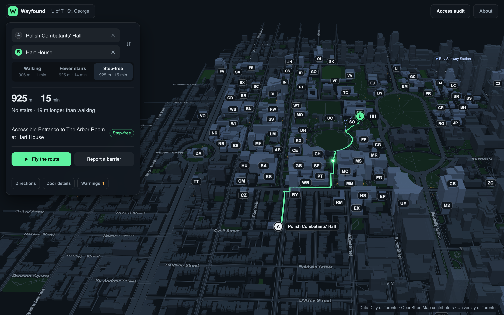

# Wayfound

Step-free, door-to-door campus routing on a 3D map built from open data.

Type a room such as `BA 1130`. Wayfound routes along real mapped paths to a real door, tells you the floor, and
shows what the step-free route costs compared with walking. Its access audit then ranks which stair flight the
campus should fix first.

This build covers the **University of Toronto, St. George campus**. The interface shows only what a journey needs;
directions, door details, floors and warnings open from their own buttons.

**Live demo:** https://aaru1801.github.io/wayfound/ (the offline single file is
[Wayfound.html](https://aaru1801.github.io/wayfound/Wayfound.html)). Built at ONHacks 2026.



## Run

```sh
npm start                # http://127.0.0.1:4310
npm test                 # 40 engine and dataset tests
npm run build:offline    # writes Wayfound.html: one file, opens by double-click, no network
```

There is nothing to install. `npm start` needs Python 3 (a static file server); the tests and the offline build need
Node 20 or newer. No API keys, accounts or environment variables.

## What it is built from

| | Source |
| --- | --- |
| 3D buildings | City of Toronto Open Data, 3D Massing (3,667 shapes around campus) |
| Paths, stairs, crossings | OpenStreetMap (12,961 walkable segments, 210 mapped stairways) |
| Doors | 346 entrance descriptions from U of T's campus map, classified by rule: 184 step-free, 146 stairs, 16 unclear |
| Building codes and addresses | Cobalt U of T datasets |

Nothing is fetched while the app runs. The campus is one JSON file, `data/uoft.json`.

The same pipeline also builds the University of Waterloo (with the university's own open data: 66 buildings and
65 accessible entrances) and McMaster University (OpenStreetMap only). Both datasets are in `data/` and are covered
by the tests, but the interface does not show a campus switch; open them with `#campus=waterloo` or
`#campus=mcmaster` in the address.

## How it works

1. `tools/build_campus.py` (Python standard library only) merges the sources into one dataset per campus: the
   walking network, 3D building shapes, places, and every door with its access class and where that came from.
2. `src/engine.js` is the routing engine: Dijkstra over typed arrays, three profiles (walking, fewer stairs,
   step-free), search, room numbers, and the audit. It has no dependencies and runs in Node and in the browser.
3. `src/map3d.js` draws the campus with MapLibre GL from the dataset alone. There are no map tiles and no font
   server; labels are drawn to canvas.
4. `src/app.js`, `index.html` and `src/styles.css` are the interface.
5. `tools/build_offline.mjs` bundles everything into `Wayfound.html`.

### The fix-first ranking is exact

The audit routes every pair of buildings twice, walking and step-free, and keeps one step-free shortest-path tree
per building. A stair flight replaced by a ramp is one new edge of length `L` between its ends `u` and `v`, and a
shortest path uses a new edge at most once, so the best distance from A to B after the fix is

```
min( d(A,B),  d(A,u) + L + d(v,B),  d(A,v) + L + d(u,B) )
```

All three terms are already stored, so every candidate fix costs one lookup per pair of buildings. The tests check
the ranking against a brute-force recomputation on a synthetic graph and on real campus data.

## Honest limits

- Outdoor routes only. A route ends at a door; the floor comes from the room number, not from a floor plan.
- A door is step-free only where U of T's own description says so (a ramp or a level approach) or OpenStreetMap
  tags it. Unclear descriptions are labelled unverified, and the original sentence is one button away.
- The router knows only what OpenStreetMap contributors have mapped.
- Barriers you report are stored in your browser. There is no live feed of closures or elevator outages.
- This is a prototype, not a safety-critical navigation aid.

## More

- [DEMO.md](DEMO.md): the three-minute demo and the numbers behind it.
- [docs/DATA.md](docs/DATA.md): data sources, licences and the commands that rebuild each campus.
- [DEVPOST.md](DEVPOST.md): submission copy.

Built with AI coding assistance (Claude Code; an earlier prototype, kept in `legacy/v1/`, used OpenAI Codex).
There is no language model at runtime: routing and the audit are deterministic graph algorithms.
